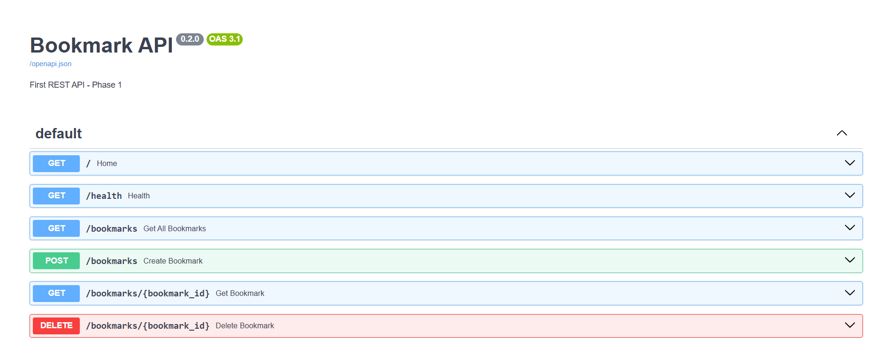

# 🧠 AI Bookmark Manager API

A REST API for saving and organizing web bookmarks, automatically enhanced with AI-generated summaries. Built with FastAPI, SQLite, and Google Gemini.

## 🚀 The AI Feature
When you save a new bookmark, the API automatically sends the URL and title to Google's Gemini LLM. The AI reads the information and generates a one-sentence summary, which is saved into the database alongside the bookmark. 

## 🛠️ Tech Stack
- **Framework:** FastAPI (Python)
- **Database:** SQLite + SQLAlchemy ORM
- **Data Validation:** Pydantic
- **AI Integration:** Google Gemini API (`google-genai`)
- **Environment Management:** `python-dotenv`

## 📸 Screenshots


## ⚙️ How to Run Locally

1. **Clone the repository:**
   ```bash
   git clone https://github.com/sayanbiswas-git/Bookmark-API.git
   cd Bookmark-API